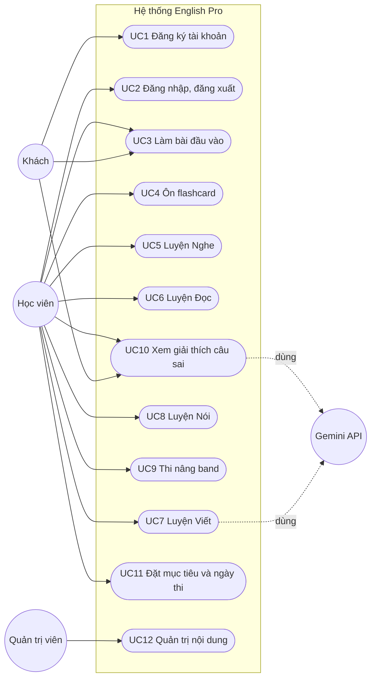
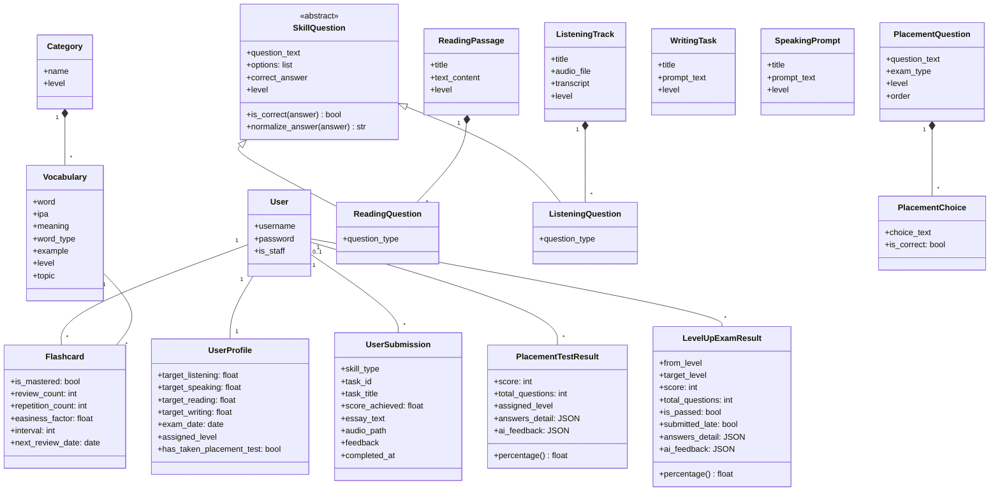
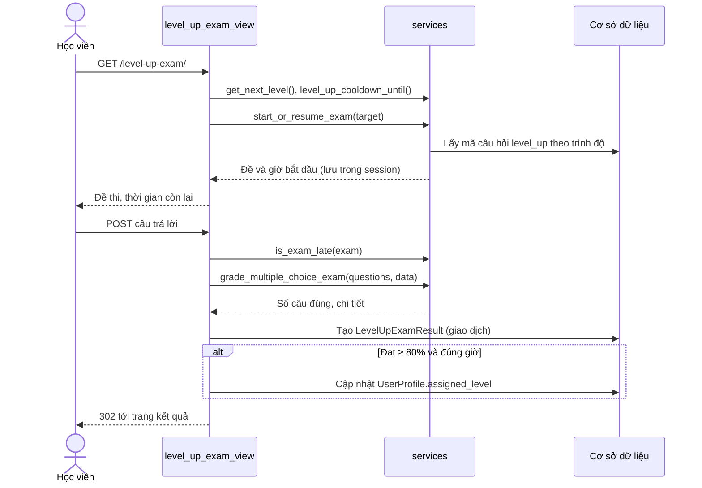
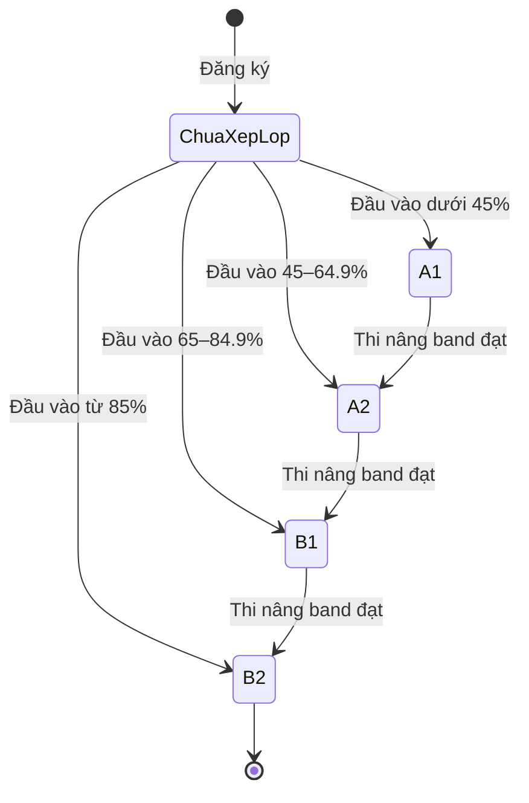
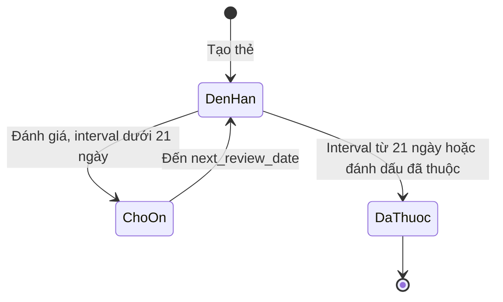
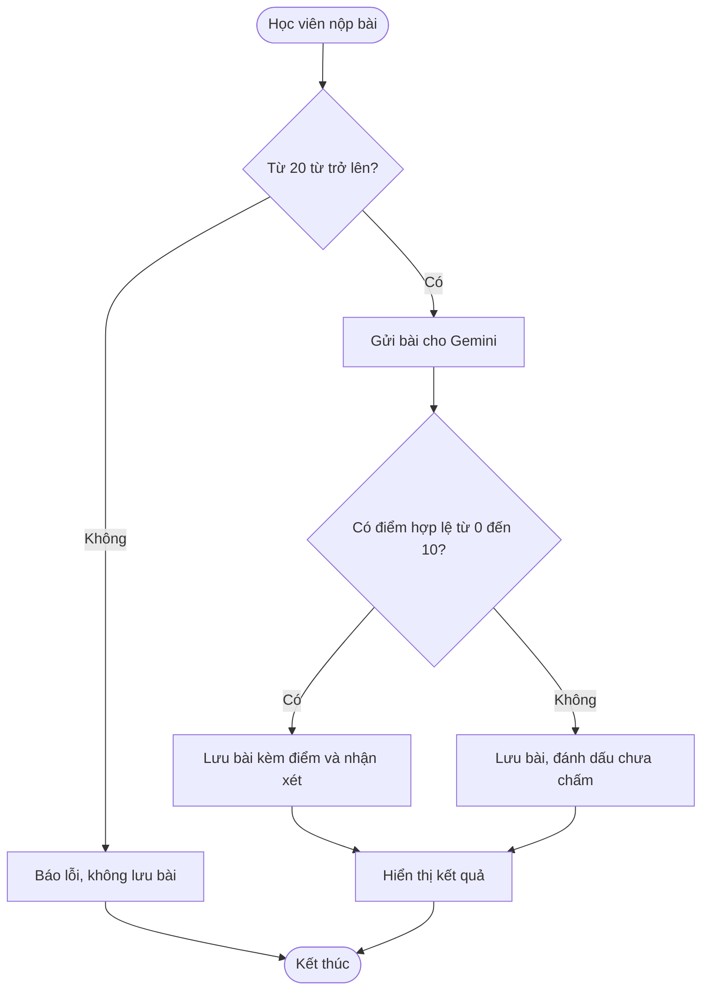
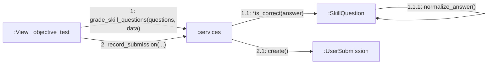
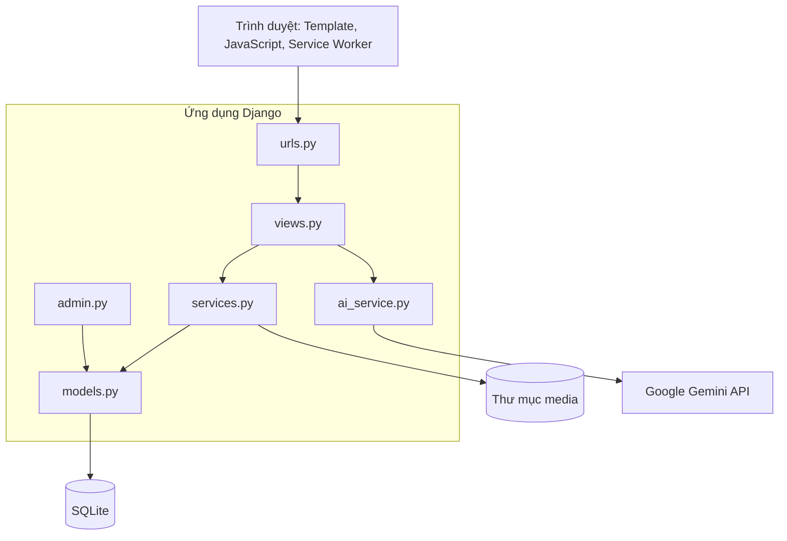
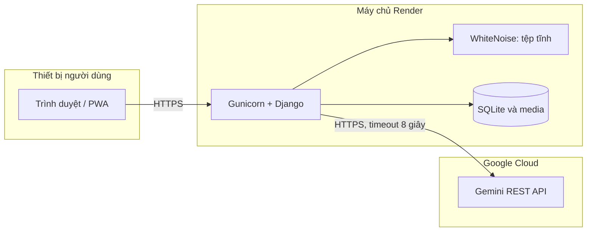

# Phân tích và thiết kế hướng đối tượng – English Pro

Tài liệu bám theo các chương của giáo trình *Phân tích, thiết kế hướng đối tượng bằng UML*: ca sử dụng (Ch.3), mô hình khái niệm và biểu đồ lớp (Ch.4), mô hình động thái và hợp đồng (Ch.5), mẫu gán trách nhiệm (Ch.6), kiến trúc và triển khai (Ch.7). Mọi biểu đồ viết bằng Mermaid và mô tả đúng mã nguồn hiện tại.

## 1. Bài toán và yêu cầu

**Mục tiêu:** giúp người học xác định trình độ CEFR (A1–B2), học từ vựng bằng flashcard lặp lại ngắt quãng, luyện 4 kỹ năng và lên trình độ qua bài thi.

| Mã | Yêu cầu chức năng | Ca sử dụng |
|---|---|---|
| R1 | Đăng ký, đăng nhập, đăng xuất | UC1, UC2 |
| R2 | Xếp trình độ bằng bài đầu vào, mỗi tài khoản một lần | UC3 |
| R3 | Học flashcard theo thuật toán SM-2 | UC4 |
| R4 | Luyện Nghe, Đọc, Viết, Nói theo trình độ đã mở khóa | UC5–UC8 |
| R5 | Thi nâng band, đạt từ 80%, có giới hạn thời gian | UC9 |
| R6 | Xem giải thích câu sai | UC10 |
| R7 | Đặt mục tiêu, ngày thi, xem tiến độ | UC11 |
| R8 | Quản trị nội dung | UC12 |

**Yêu cầu phi chức năng:**
- Bảo mật: mật khẩu theo chuẩn Django, chống CSRF, chỉ chủ bài làm xem được kết quả, không lưu khóa bí mật trong mã nguồn.
- Sẵn sàng: dịch vụ AI lỗi thì hệ thống vẫn phản hồi nhưng không tạo điểm giả.
- Trung thực dữ liệu: chỉ hiển thị điểm khi bài thực sự được chấm.

## 2. Biểu đồ ca sử dụng (Ch.3)

Mermaid không có ký hiệu ca sử dụng riêng nên tác nhân được vẽ bằng hình tròn kép và ca sử dụng bằng hình bo tròn.

### Đặc tả các ca sử dụng chính

**UC3 – Làm bài đầu vào**
- **Tác nhân:** Khách hoặc Học viên (người bắt đầu).
- **Mô tả:** Người dùng trả lời 40 câu trắc nghiệm A1–B2, hệ thống chấm và xếp trình độ.
- **Tham chiếu:** R2; UC1 (kết quả của khách được gán khi đăng ký).

| Hành động của tác nhân | Phản hồi của hệ thống |
|---|---|
| 1. Mở bài đầu vào | 2. Kiểm tra đã làm chưa; nếu chưa, hiển thị đề |
| 3. Chọn đáp án và nộp bài | 4. Chấm điểm, quy đổi CEFR, lưu kết quả, cập nhật trình độ |
| | 5. Hiển thị kết quả và nhận xét |

*Luồng phụ:* học viên đã làm bài → chuyển tới kết quả cũ; khách → kết quả lưu theo phiên và được gán cho tài khoản khi đăng ký hoặc đăng nhập.

**UC9 – Thi nâng band**
- **Tác nhân:** Học viên.
- **Mô tả:** Học viên làm 10 câu rút ngẫu nhiên từ ngân hàng riêng của trình độ kế tiếp, trong 10 phút.
- **Tham chiếu:** R5.

| Hành động của tác nhân | Phản hồi của hệ thống |
|---|---|
| 1. Mở bài thi | 2. Kiểm tra trình độ và thời gian chờ thi lại |
| | 3. Rút đề, lưu đề và giờ bắt đầu ở server, hiển thị đồng hồ |
| 4. Trả lời và nộp bài (hoặc tự nộp khi hết giờ) | 5. Chấm điểm, kiểm tra thời gian |
| | 6. Đạt từ 80% và đúng giờ: nâng trình độ. Không đạt: giữ nguyên và bắt đầu thời gian chờ 24 giờ |
| | 7. Chuyển sang trang kết quả (mẫu Post/Redirect/Get) |

*Luồng phụ:* đã ở B2 → thông báo trình độ cao nhất; nộp quá giờ → lưu bài nhưng không tính đạt; đang trong thời gian chờ → hiển thị thời điểm được thi lại.

**UC4 – Ôn flashcard**
- **Tác nhân:** Học viên.
- **Mô tả:** Học viên lật thẻ đến hạn và tự đánh giá mức nhớ; hệ thống tính lịch ôn theo SM-2.
- **Tham chiếu:** R3.

**UC7 – Luyện Viết**
- **Tác nhân:** Học viên, Gemini API.
- **Mô tả:** Học viên nộp bài từ 20 từ trở lên. Gemini chấm theo thang 10; nếu dịch vụ không khả dụng, bài được lưu và đánh dấu chưa chấm.
- **Tham chiếu:** R4.

**UC8 – Luyện Nói**
- **Tác nhân:** Học viên.
- **Mô tả:** Học viên ghi âm và nộp. Hệ thống kiểm tra định dạng và dung lượng rồi lưu file. Phiên bản hiện tại chưa chấm tự động nên bài không có điểm.
- **Tham chiếu:** R4.

## 3. Biểu đồ lớp (Ch.4)

### Từ điển thuật ngữ

| Thuật ngữ | Ý nghĩa |
|---|---|
| CEFR | Khung tham chiếu ngôn ngữ chung châu Âu; hệ thống dùng A1, A2, B1, B2 |
| Trình độ đã đạt (`assigned_level`) | Trình độ cao nhất học viên được học, chỉ tăng qua bài thi nâng band |
| Trình độ đang học (`active_level`) | Trình độ học viên đang chọn, không vượt quá trình độ đã đạt |
| Thi nâng band | Bài thi từ trình độ hiện tại lên trình độ kế tiếp |
| Điểm kỹ năng | Điểm thang 10 của bài luyện; để trống nếu bài chưa được chấm |
| SM-2 | Thuật toán tính khoảng cách ôn tập theo mức độ nhớ |
| Giáo trình (`Category`) | Nhóm từ vựng theo trình độ |
| Nhóm từ (`topic`) | Nhóm từ theo nội dung, dùng để lọc flashcard |

## 4. Biểu đồ trình tự: nộp bài thi nâng band (Ch.5)

### Hợp đồng hoạt động

**Hợp đồng `nộp bài thi nâng band`**
- **Trách nhiệm:** chấm bài và cập nhật trình độ nếu đạt.
- **Tham chiếu:** UC9, R5.
- **Tiền điều kiện:** học viên đã đăng nhập; session có đề thi cho trình độ kế tiếp.
- **Hậu điều kiện:** một `LevelUpExamResult` được tạo; đề thi bị xóa khỏi session; nếu đạt từ 80% và đúng giờ thì `assigned_level` tăng một bậc.

**Hợp đồng `review_flashcard(card, quality)`**
- **Trách nhiệm:** cập nhật lịch ôn theo SM-2.
- **Tham chiếu:** UC4, R3.
- **Tiền điều kiện:** thẻ thuộc về học viên; `quality` là số nguyên 0–5.
- **Hậu điều kiện:** `easiness_factor` không nhỏ hơn 1.3; `review_count` tăng 1; `next_review_date` được tính lại; thẻ được đánh dấu đã thuộc khi `interval` từ 21 ngày.

## 5. Biểu đồ trạng thái (Ch.5)

### Trình độ của học viên

### Flashcard

## 6. Biểu đồ hoạt động: chấm bài Viết (Ch.5)

## 7. Biểu đồ cộng tác: chấm bài Đọc/Nghe (Ch.6)

### Áp dụng mẫu gán trách nhiệm (tr.133–138)

| Mẫu | Áp dụng trong hệ thống |
|---|---|
| **Expert** | `SkillQuestion` giữ đáp án nên tự kiểm tra câu trả lời; kết quả tự tính `percentage` |
| **Creator** | `record_submission()` tạo bản ghi bài nộp; `sync_flashcards()` tạo thẻ cho học viên |
| **Low Coupling** | Mẫu giao diện không biết cách chấm; view chỉ phụ thuộc vào hàm trong `services.py` |
| **High Cohesion** | `services.py` chứa quy tắc nghiệp vụ, `ai_service.py` chỉ lo gọi AI và bộ quy tắc giải thích |
| **Controller** | Mỗi view nhận một sự kiện hệ thống rồi chuyển cho tầng nghiệp vụ |

## 8. Biểu đồ thành phần (Ch.7)

## 9. Biểu đồ triển khai (Ch.7)

**Giới hạn đã biết của cấu hình này:** ổ đĩa trên Render không bền vững, nên CSDL SQLite và file ghi âm có thể mất khi triển khai lại. Muốn vận hành thật cần chuyển sang PostgreSQL và dịch vụ lưu trữ file.

## 10. Ánh xạ thiết kế sang mã nguồn (Ch.7)

| Thành phần thiết kế | Vị trí trong mã nguồn |
|---|---|
| Các lớp thực thể | `core/models.py` |
| Quy tắc trình độ, chấm điểm, SM-2, thi nâng band | `core/services.py` |
| Gọi Gemini và bộ quy tắc giải thích | `core/ai_service.py` |
| Bộ điều khiển | `core/views.py`, `core/urls.py` |
| Giao diện | `templates/core/` |
| Dữ liệu mẫu | `core/management/commands/` |
| Kiểm thử | `core/tests.py` |
